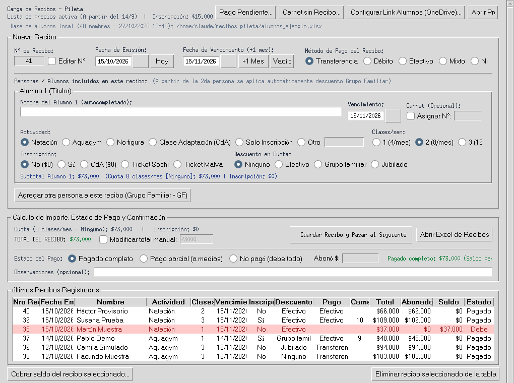

# Recibos Pileta

App de escritorio para cargar los recibos de una pileta. Reemplaza el cuaderno donde se anotaban a mano los pagos de natación y aquagym: calcula el importe, guarda todo en un Excel y lleva la cuenta de quién debe.



*Pantalla principal con datos de ejemplo (todos los nombres son inventados).*

## El problema

Los recibos se anotaban en un cuaderno: cuota según las clases por semana, descuentos (efectivo, grupo familiar, jubilados), inscripción, número de carnet, pagos a medias. Calcular el importe a mano llevaba a errores, buscar quién debía era hojear páginas, y no había forma rápida de ver lo cobrado.

## Qué hace

- **Calcula el importe solo**: lee la tabla de precios de un Excel (clases por semana × tipo de descuento + inscripción) y arma el total del recibo.
- **Recibos con varias personas**: desde la segunda persona aplica el descuento de grupo familiar automáticamente.
- **Pagos completos, parciales o pendientes**: los parciales y las deudas quedan marcados en amarillo y rojo en el Excel, y después se cobra el saldo desde la app.
- **Pagos mixtos** (parte efectivo, parte transferencia), carnets con numeración automática, y registro de carnets entregados sin recibo.
- **Autocompletado de alumnos** desde la planilla de la pileta: la sincroniza desde un link compartido de OneDrive / SharePoint / Google Sheets (en segundo plano, con caché local para trabajar sin internet) o desde un archivo local. Detecta jubilados y lee los días de clase escritos a mano ("Lu, Mi y Vi 15:30", "martes y jueves 18hs").
- **Todo queda en Excel** (`recibos.xlsx`), con formato, para que se pueda abrir y revisar sin la app.
- Numeración de recibos y carnets que respeta cuando se termina un talonario y se vuelve a empezar desde 1.

## Cómo probarla

Necesita Python 3.11 o más nuevo (con Tkinter, que viene incluido en el instalador de Windows).

```bash
pip install -r requirements.txt
python generar_datos_ejemplo.py   # crea precios, alumnos y recibos de ejemplo (inventados)
python reemplazo_cuaderno.py
```

`generar_datos_ejemplo.py` no pisa archivos que ya existan, para no borrar datos reales por error (con `--forzar` los regenera y deja una copia `.bak`).

Tests:

```bash
python -m unittest discover -s tests
```

## Estructura

| Archivo | Qué hace |
|---|---|
| `reemplazo_cuaderno.py` | Ventana principal: carga del recibo, cálculo del importe, tabla de últimos recibos |
| `ui_components.py` | Componentes de la interfaz: autocompletado, calendario, alumno del recibo, diálogos de pagos pendientes y carnets |
| `excel_manager.py` | Lectura de la tabla de precios y lectura/escritura de `recibos.xlsx` con formato |
| `alumnos_service.py` | Descarga y lectura de la planilla de alumnos (OneDrive / Google Sheets / local), caché, días de clase |
| `config.py` | Configuración y rutas de los archivos |
| `utils.py` | Fechas, moneda, nombres |
| `generar_datos_ejemplo.py` | Datos inventados para probar la app |

## Tecnologías

Python · Tkinter · pandas · openpyxl
